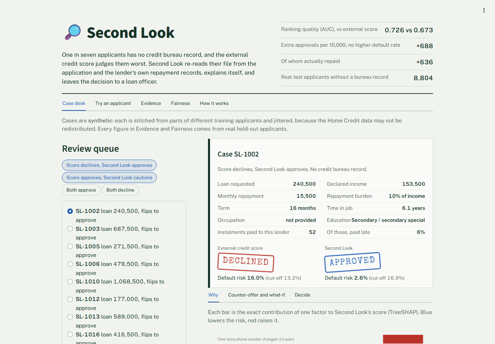
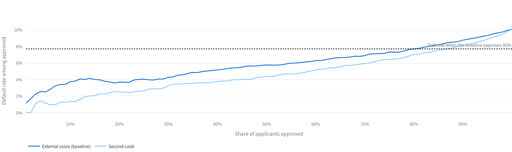
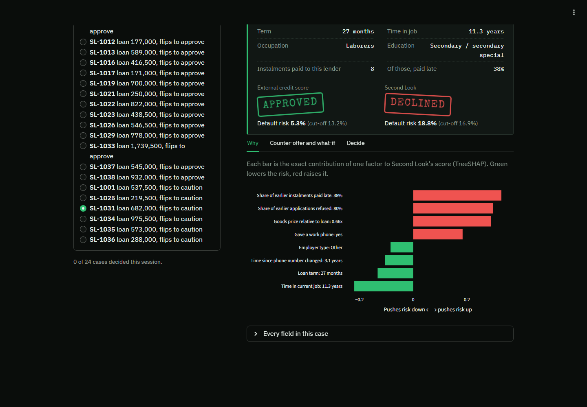

# 🔎 Second Look

**A second opinion for loan applicants the credit bureau has never heard of.**

**Neural Storm 2026 · Track 3: Human Impact · Problem statement HI-04: Alternative Credit Scoring for the Unbanked**

| | |
|---|---|
| **Team** | Aryan Mashalkar (solo) |
| **Live demo** | **https://second-look-credit.streamlit.app** |
| **Demo video** | [docs/second-look-demo.mp4](docs/second-look-demo.mp4) (2 min, captioned) |



## Judge quick start

1. Open the [live demo](https://second-look-credit.streamlit.app). Nothing to install, no login. If it has been asleep it takes about 30 seconds to wake; if a red "failed to fetch" box appears, refresh the page once.
2. **Review queue**: open any `Second look: approve` profile. The external score declines it; Second Look approves it and shows why, plus a counter-offer for declined cases.
3. **Evidence**: every number is computed on **8,804 real held-out applicants with no bureau record**, with 95% bootstrap intervals.
4. To check the numbers yourself: `python -m secondlook.train` rebuilds every metric in about 2 minutes (see [Run it locally](#run-it-locally)).

## Results

Held-out test set: 20% of the 307,511 Home Credit loans, never seen in training. **"No bureau record"** means the applicant has no rows in the credit bureau table (44,020 applicants, 14.3%).

| Model (applicants with no bureau record) | AUC (95% CI) | Gain vs external score (95% CI) |
|---|---|---|
| External score (baseline): logistic regression on `EXT_SOURCE_1/2/3` | 0.673 (0.654–0.691) | — |
| Second Look without lender history (ablation) | 0.709 (0.691–0.726) | +0.036 (+0.014 to +0.058) |
| **Second Look** | **0.726 (0.709–0.742)** | **+0.052 (+0.030 to +0.074)** |
| Second Look + external score | 0.748 (0.731–0.764) | +0.075 (+0.061 to +0.089) |

**What it means for lending.** If the external score approves 80% of no-bureau applicants, approved loans default at 7.7%. At that **same default rate**, Second Look approves 86.6%: **660 more people per 10,000**, of whom **610 actually repaid**.



| No-bureau test applicants | Count | Actually defaulted |
|---|---:|---:|
| Both approve | 6,321 | 6.2% |
| Only Second Look approves | 1,303 | 14.9% |
| Only the external score approves | 722 | 20.8% |
| Both decline | 458 | 33.6% |

The people Second Look adds default less often than the people it drops.

**Everyone, not just thin files.** On all applicants Second Look is on par with the external score (0.726 vs 0.718, gain +0.009, CI +0.000 to +0.018). It is a second opinion for thin files, not a replacement.

**Fairness audit** (gender, age and family status are not model inputs; audited at each model's cut-off):

| Group | External score approves | Second Look approves |
|---|---:|---:|
| Women | 82.2% | 89.0% |
| Men | 76.3% | 82.5% |
| Under 30 | 67.9% | 77.0% |
| 30–44 | 80.3% | 83.7% |
| 45–59 | 85.6% | 91.5% |
| 60+ | 84.5% | 98.4% |

Every group is approved more often, but **the age gap widens from 17.7 to 21.4 points**, because Second Look approves almost all over-60s. The gender gap widens by under one point. This is reported, not hidden: a lender would need to address it before deployment.

All figures come from [`artifacts/metrics.json`](artifacts/metrics.json) and [`artifacts/fairness.csv`](artifacts/fairness.csv), written by the training script. The app reads those files; nothing is typed in by hand.

## The problem

Lenders decide with bureau data and purchased external scores. People with no credit history get a weak score, or none, so they are declined or overcharged: they cannot get credit because they have never had credit. In the Home Credit data, applicants with no bureau record default more often (10.1% vs 7.7%), and the external score ranks them much worse (AUC 0.673 vs 0.718 for everyone else).

## The solution

Second Look is a **review queue for loan officers**. For every no-bureau applicant it:

1. **Re-scores** them from the application form and the **lender's own records** (earlier applications, instalment repayment behaviour), without the external scores or any bureau data.
2. **Explains** the score in plain English: the exact contribution of each factor, from TreeSHAP.
3. **Proposes a counter-offer** for declined applicants: the smallest change in loan amount or term that brings risk inside the cut-off. It changes only lender-negotiable terms, never who the person is.
4. **Leaves the decision to a person**: the officer records approve, counter-offer, request documents or decline, with a mandatory reason, in an exportable log.



## How it works

```
application_train.csv ──┐
previous_application.csv ┼─► features.py ──► one row per applicant (42 features, HAS_BUREAU flag)
installments_payments.csv┘                      │
bureau.csv (IDs only) ──────────────────────────┘
                                                 ▼
             stratified 80/20 split (by default × bureau status), 15% of train for early stopping
                                                 ▼
   ┌──────────────────────┬────────────────────────────┬──────────────────────────┐
   │ Baseline             │ Second Look                │ Ablation / combined      │
   │ LogReg on EXT_SOURCE │ LightGBM, monotone         │ no lender history /      │
   │                      │ constraints, no protected  │ + EXT_SOURCE             │
   │                      │ or bureau fields           │                          │
   └──────────────────────┴────────────────────────────┴──────────────────────────┘
                                                 ▼
  evaluate.py: paired-bootstrap AUC · matched-bad-rate policy · fairness by group · importance
                                                 ▼
        artifacts/ (model, thresholds, metrics, curves, synthetic demo profiles) ──► Streamlit app
```

- **Features**: affordability ratios (loan/income, monthly repayment/income, term, goods price/loan), employment, region, documents, social-circle defaults, and the lender's history: earlier applications, refusal share, and late, underpaid and days-late instalment rates.
- **Excluded from Second Look**: `EXT_SOURCE_*` (that is the baseline), bureau enquiry counts, gender, age and family status.
- **Monotone constraints**: more late payments, underpayment, refusals, social-circle defaults or a heavier repayment burden can never lower risk. This keeps explanations and counter-offers consistent with common sense, at a cost of 0.0006 AUC.
- **Cut-offs**: the baseline approves 80% of no-bureau applicants. Second Look's cut-off is the most generous one with the same default rate on test data.
- **Counter-offers**: a grid search over loan amount (50–100%) and term (75–150%), ordered by how big the change is, capped at 72 months.

## Technology

Python 3.13 · LightGBM 4.6 · scikit-learn 1.7 · pandas 2.3 · NumPy 2.3 · Streamlit 1.50 · Plotly 6.3 · pytest · Playwright (screenshots) · GitHub Actions (CI).

## Run it locally

```bash
git clone <this repo> && cd second-look
python -m venv .venv
.venv/Scripts/activate        # Windows; use source .venv/bin/activate on macOS/Linux
pip install -r requirements.txt
streamlit run streamlit_app.py
```

The app runs straight from the committed artifacts. To retrain and recompute every metric from the real data:

```bash
pip install -r requirements-dev.txt
# accept the competition rules at kaggle.com/competitions/home-credit-default-risk/rules first
mkdir -p data/raw && cd data/raw
for f in application_train bureau previous_application installments_payments; do kaggle competitions download -c home-credit-default-risk -f $f.csv -p . && unzip -o $f.csv.zip; done
cd ../..
python -m secondlook.train     # about 2 minutes on a laptop CPU; rewrites artifacts/
pytest -q                      # 11 tests: features, metrics, and checks on the shipped model
```

## Repository

| Path | What it is |
|---|---|
| `secondlook/features.py` | Raw tables → one row per applicant |
| `secondlook/train.py` | Trains all four models, evaluates, writes `artifacts/` |
| `secondlook/evaluate.py` | Paired bootstrap, policy curves, fairness |
| `secondlook/model.py` | Scoring, reason codes, counter-offers |
| `secondlook/demo_data.py` | Synthetic demo profiles |
| `streamlit_app.py` | The loan-officer app |
| `tests/` | Unit tests and artifact checks |
| `artifacts/` | Trained model, thresholds, metrics, curves, demo profiles, training log |

## Limitations

- **Selection bias.** Outcomes exist only for people Home Credit lent to. Repayment of rejected applicants is unknown, so the claims are about *approved borrowers without a bureau record*, not the unbanked population as a whole.
- **Not Indian data.** The lender and country are not disclosed. The method transfers; the model would need retraining on local data.
- **Most no-bureau applicants (94%) had applied to this lender before.** Without that history the gain roughly halves (ablation: +0.036 instead of +0.052). For true first-time borrowers the benefit is smaller.
- **Age gap.** See the fairness audit above.
- **Counter-offers are correlational.** They describe what the model responds to, not a guarantee of repayment.
- **Random split.** The data has no application dates, so the test set is a random hold-out, not a later time period.
- **Prototype.** Not a validated credit model; not for real lending decisions.

## Data and privacy

Data: [Home Credit Default Risk](https://www.kaggle.com/competitions/home-credit-default-risk), used under the competition's rules. **No raw rows are committed or deployed.** The demo profiles in `artifacts/demo_profiles.csv` are synthetic: each is assembled from blocks of fields (loan terms, work, home, social circle, history, external scores) taken from *different* random training applicants, then jittered, so no profile is a real person ([`secondlook/demo_data.py`](secondlook/demo_data.py)). Gender and age are used only to audit fairness.

## AI tools used

The demo video is a real screen recording of the app (Playwright, `video/record.py`) with an **AI-generated voiceover from ElevenLabs** (premade voice "Eric", script in `video/make_voiceover.py`) and burned-in captions.

This project was built with **Claude Code (Anthropic, Claude Opus 5.5)**, which helped research the problem space, write the code, tests and README, and debug. One bug it caught: `AMT_ANNUITY` is a monthly payment, not yearly. The modelling choices, evaluation design and every reported number were checked by running the code on the real data; the numbers in this README are copied from `artifacts/metrics.json`.
